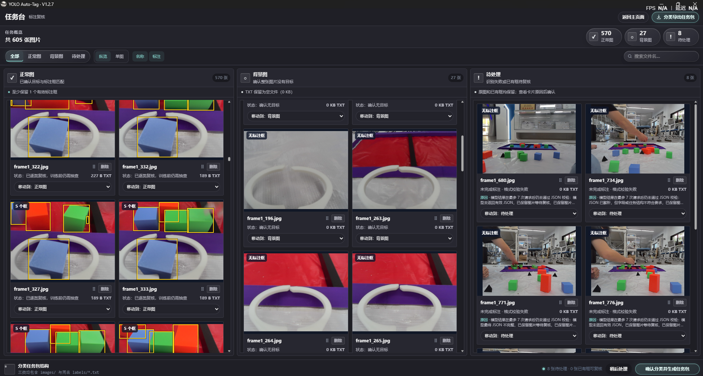
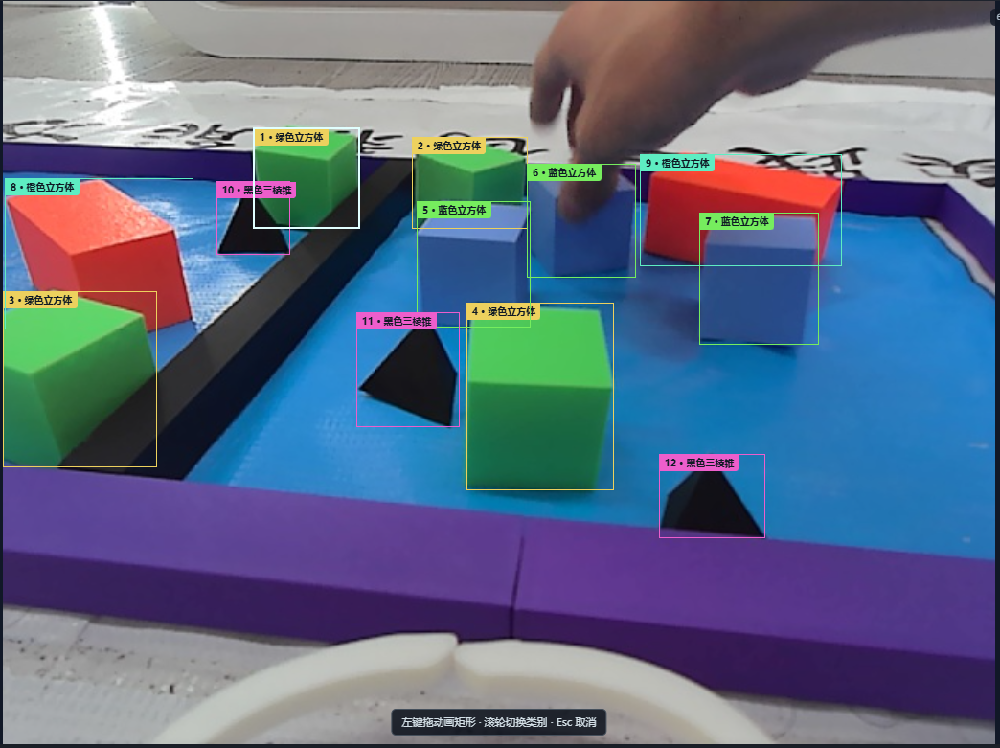
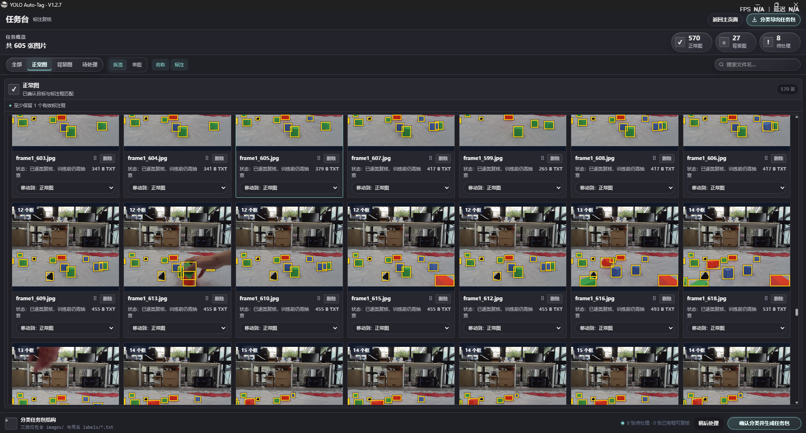
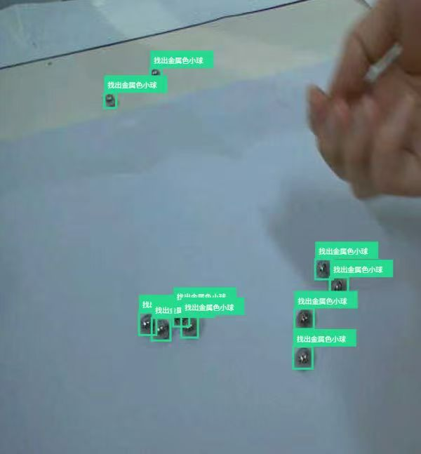

# YOLO Auto-Tag

**AI 批量标注，人工修改同样顺手。**

让 AI 先生成候选标注，再用熟悉的绘图操作补框、改类和复核。把自动标注与人工编辑放在同一个桌面工具里，让 YOLO 数据集整理更方便。

Windows 10/11 x64 · V1.2.7

[下载 Windows 版](https://github.com/lindonky/YOLO-AI-AUTO-TAG/releases/tag/V1.2.7) · [查看更新](https://github.com/lindonky/YOLO-AI-AUTO-TAG/releases) · [反馈问题](https://github.com/lindonky/YOLO-AI-AUTO-TAG/issues)

## AI 先标，结果集中看

导入图片，填写类别与目标描述，即可批量生成候选标注。任务台集中展示不同状态，方便找到需要检查和修正的图片。



## 手工修正，像画图一样直接

选“标注”后，左键拖动就能画框；选中已有框即可移动、缩放和改类。滚轮快速切换类别，Ctrl+Z 撤销，右键复制或删除。类别支持全局增删改，整批数据一起管理。



## 多图纵览，检查更连贯

整批结果放在一起看，支持文件名搜索、单图编辑与分类复核。发现漏框就补，类别不对就改，检查后导出 YOLO 标签。



## 用自己的目标，试自己的场景

从彩色积木到金属小球，可以通过类别、文字描述和人工示例设置标注任务。



*示例用于展示界面和标注结果；实际识别效果取决于图片与所选模型，建议复核后用于训练。*

## 开始使用

1. 从 [Releases](https://github.com/lindonky/YOLO-AI-AUTO-TAG/releases/tag/V1.2.7) 下载并安装 Windows 版。
2. 配置支持图片输入的 AI 模型 API，导入图片并填写目标描述。
3. 开始批量标注，或直接进入人工标注；检查完成后导出标签。

AI 识别调用用户配置的 API 服务，需自行准备相应 API Key。

<details>
<summary>开发与构建</summary>

Python 3.11–3.13 · JavaScript · pywebview / WebView2 · Inno Setup 6

```powershell
python -m venv .venv
.\.venv\Scripts\python.exe -m pip install -r desktop\requirements-desktop.txt
.\.venv\Scripts\python.exe desktop\prepare_desktop_assets.py
.\.venv\Scripts\python.exe desktop\desktop_app.py
.\desktop\build_test.ps1 -Python .\.venv\Scripts\python.exe
```

构建输出：`desktop/dist/`、`desktop/output/`。第三方说明见 [NOTICE.md](NOTICE.md)。

</details>
